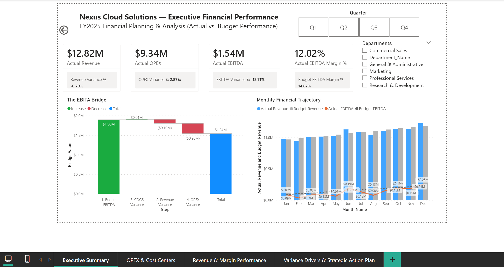

# Budget vs Actual FP&A and EBITDA Variance Analytics

### Revenue, OPEX and EBITDA Performance Against Budget, with Variance Drivers and Management Actions


[](screenshots/01_Executive_Summary.png)

*Select the image to view it at full size.*

---

## Project Overview

This project is a simulated FP&A analysis for a fictional mid-market SaaS and IT services company, Nexus Cloud Solutions. It compares FY2025 actual results with the approved operating budget, identifies what drives the gap between budgeted and actual EBITDA, and sets out management actions.

The analysis uses Python for exploratory data analysis and Power BI for the reporting layer. The dashboard has four pages: executive performance, OPEX and cost centres, revenue and margin, and variance drivers with an action plan.

The business questions are:

1. How did actual performance compare with the approved budget?
2. What drove the gap between budgeted and actual EBITDA?
3. Which departments and accounts contributed most to the OPEX variance?
4. How did each revenue stream perform?
5. Which variances are material enough to act on?

### Data Source

**Data Source:** Synthetically generated for this project using Python with a fixed random seed, so results are reproducible. The company, records, and business scenarios are fictional and are intended for learning and portfolio demonstration.

---

## Key Metrics (FY2025, actual against budget)

| Actual Revenue | Actual OPEX | Actual EBITDA | EBITDA Margin | Gross Margin |
| --- | --- | --- | --- | --- |
| **$12.82M** (−0.8%) | **$9.34M** (+2.9%) | **$1.54M** (−18.7%) | **12.0%** (budget 14.7%) | **84.9%** (budget 85.0%) |

Percentages in brackets are variances against budget. EBITDA here is gross profit less OPEX. The dataset has no depreciation or amortisation.

---

## Key Findings

1. **Total revenue was close to budget, but the streams differed.** Revenue was $102K (0.8%) below budget. Enterprise and Mid-Market subscriptions were within 1% of budget. Implementation and consulting services were $113K (6.1%) below budget.
2. **The services shortfall was concentrated in Q3.** Services revenue was 15.4% ($73.8K) below budget from July to September. It was close to budget in the other months.
3. **OPEX ran $260K (2.9%) over budget, driven by three accounts.**
   - R&D cloud testing and staging compute: $104K over budget (18.4%). The overrun ran from May to September, with monthly variances of 36% to 52%.
   - Performance advertising and demand generation: $103K over budget (9.7%). Most of the overrun fell between February and May, with monthly variances of 26% to 34%.
   - Legal, audit and professional fees: $43K over budget (11.5%). Almost all of it is a single $42K one-time legal charge in August.
4. **EBITDA fell further than revenue.** EBITDA was $355K (18.7%) below budget. Revenue accounted for −$102K, OPEX for −$260K, and COGS for +$8K.
5. **Gross margin was almost unchanged,** so the EBITDA gap comes from revenue and OPEX, not from delivery costs.
6. **Marketing spend and subscription revenue show no positive link in this data.** The same-month correlation between performance advertising and Enterprise SaaS revenue is −0.51. The one-month-lag correlation is −0.04. With only 12 monthly observations, neither result supports a conclusion about marketing effectiveness.

**What these findings do not show:** The results come from a simulated dataset, and the variances were built into the generator. They describe the dataset, not a real company. The dataset contains no prior-year figures, so no growth trend can be measured. It also contains no customer, pipeline or headcount data, so the causes of the services shortfall and the marketing result cannot be identified from it.

---

## Business Problem and Objectives

Management needs to know whether revenue performance is translating into profit, which cost lines are pressuring margin, and where corrective action should go first. The project aims to:

1. Compare actual and budget performance across revenue, COGS, OPEX, gross profit, EBITDA and margins.
2. Explain the EBITDA variance as a bridge from budget to actual.
3. Identify account and department overruns, and separate one-time items from recurring ones.
4. Give management a short list of prioritised actions.

---

## Methodology

**Python.** The generator creates FY2025 monthly budget and actual figures for 14 accounts and 5 departments, using seed 42. Exploratory analysis in the notebook checks data integrity, calculates OPEX and revenue variances, flags statistical outliers with a z-score, and tests the marketing-to-revenue relationship with same-month and lagged correlations. `verify_data.py` prints monthly totals and ranges as a quick summary.

**Power BI.** A star-schema model with the financial fact table, account and department dimensions, a date table, and a small bridge table that orders the EBITDA waterfall. Measures cover revenue, COGS, gross profit, gross margin, OPEX, EBITDA, EBITDA margin, budget and actual variances, OPEX budget utilisation, variance severity and bridge values. Measure definitions are in [`documentation/dax_measures.md`](documentation/dax_measures.md).

**Variance convention.** All variances are shown as favourable positive. A negative value is unfavourable, so an OPEX overspend appears as a negative number.

**Severity thresholds.** Expense overrun above $50K is "Critical Overspend"; $15K to $50K is "Moderate Overrun"; revenue shortfall above $50K is "Major Revenue Miss". These are analytical thresholds chosen for this project, not company policy.

---

## Dashboard

1. **[Executive Summary](screenshots/01_Executive_Summary.png):** headline KPIs, EBITDA bridge from budget to actual, and monthly revenue, budget and EBITDA trajectory.
2. **[OPEX & Cost Centers](screenshots/02_OPEX_and_Cost_Centers.png):** OPEX against budget, department discipline, monthly spend run-rate, and an account-level breakdown.
3. **[Revenue & Margin Performance](screenshots/03_Revenue_and_Margin_Performance.png):** revenue by stream, monthly revenue and gross margin, and an account-level variance table.
4. **[Variance Drivers & Action Plan](screenshots/04_Variance_Drivers_Action_Plan.png):** KPI variances, budget-to-actual scatter, a variance audit grid with severity status, and three management actions.

---

## Management Actions

These are proposed actions based on the findings above.

1. **R&D cloud compute governance.** Automate shutdown of non-production environments, and tag compute by owner so spend can be traced. Target: keep the account within budget in the next cycle.
2. **Marketing efficiency review.** Measure campaign-level returns before approving further increases in performance advertising. The current data cannot show a return, so measurement has to come first.
3. **Professional services capacity.** Review the Q3 services pipeline and delivery utilisation to find out whether the shortfall came from bookings or from delivery capacity. The dataset does not include either, so this needs source data.
4. **One-time legal costs.** Confirm whether the August legal charge is recognised as one-time, and require approval for similar items above a set threshold.

---

## Repository Structure

```text
nexus-fpa-analytics/
├── README.md
├── dashboard/
│   └── Nexus_Cloud_Solutions_FPA.pbix
├── data/
│   ├── raw/
│   │   ├── Dim_Account.csv
│   │   ├── Dim_Department.csv
│   │   └── Fact_Financials.csv
│   └── processed/
│       ├── Bridge_Structure.xlsx
│       └── Dim_date.xlsx
├── documentation/
│   └── dax_measures.md
├── script/
│   ├── 01_generate_data.py
│   ├── 02_exploratory_data_analysis.ipynb
│   └── verify_data.py
└── screenshots/
    ├── 01_Executive_Summary.png
    ├── 02_OPEX_and_Cost_Centers.png
    ├── 03_Revenue_and_Margin_Performance.png
    └── 04_Variance_Drivers_Action_Plan.png
```

---

## How to Reproduce

Run these commands from the `script/` folder, because the scripts use relative paths.

```bash
cd script
pip install numpy pandas
python 01_generate_data.py     # writes data/raw/ using seed 42
python verify_data.py          # prints monthly totals and ranges
```

Open `02_exploratory_data_analysis.ipynb` in Jupyter from the `script/` folder to rerun the exploratory analysis.

**Dashboard:** open `dashboard/Nexus_Cloud_Solutions_FPA.pbix` in Power BI Desktop. If a file path does not resolve, point each source to the matching file in `data/` (Home > Transform data > Data source settings).

---

## Limitations

- **Simulated data.** Budget and actual figures, and the variance scenarios, are set by the generator.
- **One year only.** There is no prior-year comparison, so no growth can be measured.
- **Small sample for correlations.** The marketing correlation uses 12 monthly points.
- **EBITDA is defined here as gross profit less OPEX.** The dataset has no depreciation, amortisation, tax or other income.
- **No drivers beyond the accounts.** There is no customer, pipeline, headcount or utilisation data, so causes cannot be confirmed.
- **Thresholds are project choices**, not company policy.

---

## Disclaimer

This is a simulated portfolio project. The company, financial data, business scenarios and management actions are fictional and do not represent the financial performance or internal operations of any real organisation.

---

**Author:** [Sarthak Jaykar](https://www.linkedin.com/in/sarthak-jaykar/)
