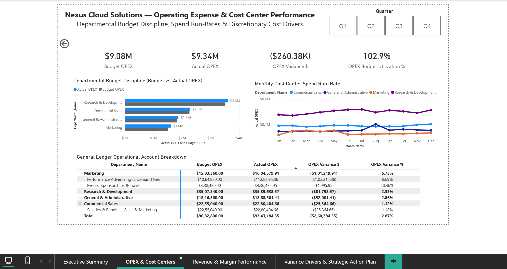
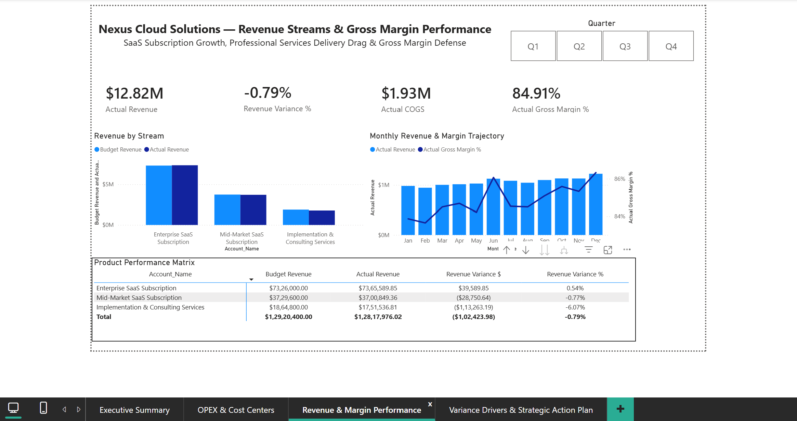
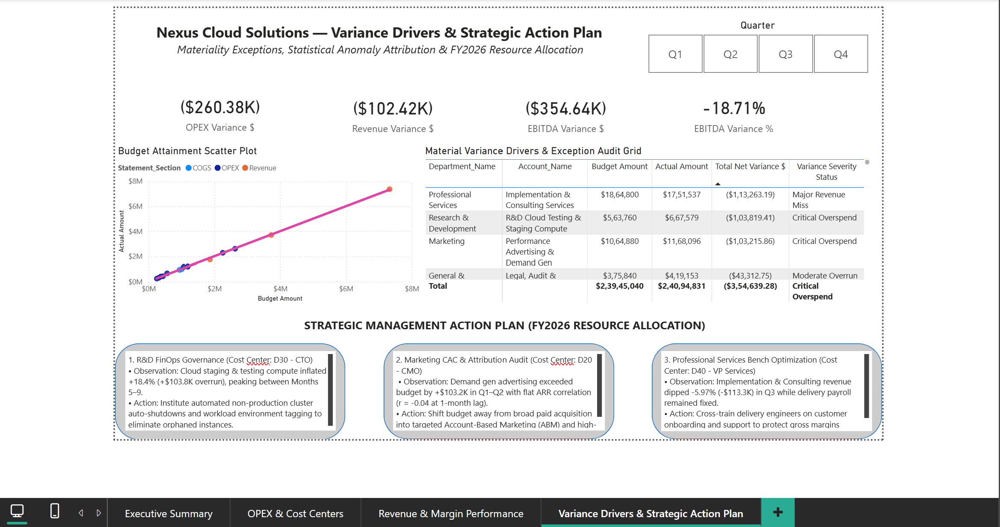

# Nexus Cloud Solutions — Financial Planning & Analysis (FP&A) Dashboard


## 📌 Project Overview

This project presents a simulated **Financial Planning & Analysis (FP&A) solution** for a mid-market enterprise SaaS and IT services company, **Nexus Cloud Solutions Inc.**

The project analyzes financial performance against the approved operating budget and uses **Python for exploratory data analysis (EDA)** followed by **Power BI for interactive financial reporting and management analysis**.

The objective is to move beyond financial reporting and identify the business drivers behind revenue, cost, margin, and EBITDA performance.

The final solution provides a four-page management dashboard covering:

* Executive financial performance
* OPEX and cost-centre performance
* Revenue and margin performance
* Variance drivers and management action areas

> **Project Type:** Simulated Finance / FP&A Analytics Portfolio Project

---

## 🎯 Business Objectives

The project was designed to help management:

* Compare **Actual vs Budget** financial performance.
* Monitor revenue, COGS, OPEX, EBITDA, and profitability.
* Identify significant budget variances and their operational drivers.
* Evaluate cost-centre and account-level spending performance.
* Analyze revenue-stream and margin trends.
* Identify unusual or material financial exceptions.
* Translate financial findings into actionable management recommendations.

---

## ❓ Key Business Questions

The analysis focuses on questions such as:

1. How did actual financial performance compare with the approved budget?
2. What is driving the gap between budgeted and actual EBITDA?
3. Which departments and cost centres are contributing most to OPEX variance?
4. Which individual accounts require management attention?
5. How are subscription and professional-services revenue streams performing?
6. How are gross margin and EBITDA margin changing over time?
7. Which financial variances are structural, temporary, or material enough to investigate?
8. Where should management prioritize corrective action?

---

## 📊 Dashboard Features

### 1. Executive Financial Performance

Provides a management-level overview of the company's financial position.

Key analysis includes:

* Actual Revenue
* Actual OPEX
* Actual EBITDA
* EBITDA Margin
* Budget vs Actual performance
* EBITDA variance bridge
* Monthly financial performance trends

The page provides a high-level view of whether revenue performance is translating into profitability.

---

### 2. OPEX & Cost Centre Performance

Provides a deeper view of operating expenditure and departmental budget discipline.

Key analysis includes:

* OPEX budget vs actual performance
* Department-level spending
* Monthly OPEX trends
* Cost-centre comparison
* Account-level drill-down
* Identification of significant spending overruns

This page helps identify where operating costs are putting pressure on profitability.

---

### 3. Revenue & Margin Performance

Analyzes revenue composition and profitability across the company's major revenue streams.

Key analysis includes:

* Revenue by stream
* Subscription performance
* Professional Services performance
* Budget vs Actual revenue
* Gross margin performance
* Monthly margin trends
* Revenue and margin comparison

The analysis helps distinguish top-line performance from the underlying margin impact of revenue mix and delivery performance.

---

### 4. Variance Drivers & Action Plan

Focuses on identifying the most material financial exceptions and translating them into management actions.

Key analysis includes:

* Budget attainment and variance analysis
* Account-level exception analysis
* Variance severity
* Material cost and revenue deviations
* Variance-driver identification
* Management action areas

The page connects financial exceptions with the relevant operational areas requiring investigation or corrective action.

---

## 💡 Key Business Insights

The analysis highlights several important financial patterns:

### Revenue Performance Was Relatively Resilient

Overall revenue remained close to the approved budget, but the result masked differences between revenue streams.

Subscription revenue performed comparatively strongly, while Professional Services experienced a notable shortfall during the later part of the year.

### R&D Infrastructure Spending Created Significant Cost Pressure

R&D cloud testing and staging compute showed sustained overspending during the middle portion of the year.

This represents a more persistent cost-management issue rather than a single-period fluctuation and therefore warrants operational investigation.

### Marketing Spending Required Closer Performance Monitoring

Performance advertising and demand-generation spending exceeded budget during the campaign period.

The analysis suggests that increased marketing expenditure did not translate into a corresponding improvement in the observed revenue trend, indicating the need for closer monitoring of marketing efficiency.

### EBITDA Was More Adversely Affected Than Revenue

The relatively small revenue gap compared with the larger EBITDA gap demonstrates the importance of monitoring the cost structure alongside top-line performance.

OPEX pressure and revenue weakness combined to create a larger impact on operating profitability.

---

## 🧪 Analytical Methodology

The project follows a business-first analytical workflow:

**Business Problem → Data Generation → Data Validation → Python EDA → Power BI Data Model → DAX Measures → Dashboard → Insights → Recommendations**

### Python EDA

Python was used before Power BI to explore the financial dataset and identify patterns requiring further investigation.

The analysis included:

* Data quality validation
* Distribution analysis
* Variance analysis
* Outlier identification
* Financial trend analysis
* Cost-driver exploration
* Revenue and expense relationships

Python was used as an exploratory analytical layer rather than simply reproducing Power BI visuals.

### Power BI

Power BI was used as the primary reporting and decision-support layer.

The model uses a structured financial data model with:

* Financial fact data
* Account dimension
* Department dimension
* Date dimension
* Supporting bridge structure for variance analysis

DAX measures were developed for:

* Revenue
* COGS
* Gross Profit
* Gross Margin
* OPEX
* EBITDA
* EBITDA Margin
* Budget vs Actual Variances
* OPEX utilization
* Variance severity
* EBITDA bridge analysis

Detailed DAX logic is available in [`documentation/dax_measures.md`](documentation/dax_measures.md).

---

## 🛠️ Tools & Technologies

* **Power BI Desktop** — Data modeling, DAX, interactive dashboard development
* **Python** — Exploratory Data Analysis and data validation
* **Pandas** — Data preparation and analysis
* **NumPy** — Numerical analysis and synthetic data generation
* **Jupyter Notebook** — Exploratory analysis
* **CSV** — Financial dataset storage

---

## 📁 Dataset

The project uses a **synthetic financial dataset** designed to represent a realistic enterprise SaaS / IT services FP&A environment.

The dataset contains:

* Monthly financial records for FY2025
* Budget and Actual scenarios
* Revenue accounts
* COGS accounts
* OPEX accounts
* Departments / cost centres
* Account classifications

The synthetic data intentionally includes realistic financial variance scenarios such as:

* R&D infrastructure cost increases
* Marketing expenditure overruns
* Professional Services revenue shortfalls
* One-time legal expense impact

This allows the dashboard to demonstrate practical FP&A analysis without using confidential company information.

---

## 🖥️ Dashboard Preview

### Executive Financial Performance


### OPEX & Cost Centre Performance



### Revenue & Margin Performance



### Variance Drivers & Action Plan



---

## 📂 Repository Structure

```text
nexus-fpa-analytics/
│
├── README.md
│
├── data/
│   └── raw/
│       ├── Dim_Account.csv
│       ├── Dim_Department.csv
│       └── Fact_Financials.csv
│
├── python/
│   ├── 01_generate_data.py
│   ├── 02_exploratory_data_analysis.ipynb
│   └── verify_data.py
│
├── powerbi/
│   └── Nexus_Cloud_Solutions_FPA.pbix
│
├── documentation/
│   └── dax_measures.md
│
└── Screenshots/
    ├── 01_Executive_Summary.png
    ├── 02_OPEX_and_Cost_Centers.png
    ├── 03_Revenue_and_Margin_Performance.png
    └── 04_Variance_Drivers_Action_Plan.png
```

---

## ▶️ How to Reproduce

### 1. Generate the Dataset

Navigate to the `python` directory and run:

```bash
python 01_generate_data.py
```

This generates the financial dataset under:

```text
data/raw/
```

### 2. Validate the Data

Run:

```bash
python verify_data.py
```

This performs basic financial validation and provides monthly financial summaries.

### 3. Explore the Data

Open:

```text
python/02_exploratory_data_analysis.ipynb
```

and run the notebook to reproduce the exploratory analysis.

### 4. Open the Power BI Report

Open:

```text
powerbi/Nexus_Cloud_Solutions_FPA.pbix
```

The Power BI report contains the completed four-page FP&A dashboard.

---

## 📄 Documentation

Additional project documentation is available in the `documentation` folder.

* [`DAX Measures Catalog`](documentation/dax_measures.md) — Key DAX calculations used in the Power BI model.

---

## ⚠️ Disclaimer

This project is a **simulated portfolio project** created for learning and demonstration purposes.

The company, financial data, business scenarios, and management recommendations are fictional and do not represent the financial performance or internal operations of a real organization.

---

## 👤 Author

**Sarthak Jaykar**

Focused on combining **business understanding, data analytics, and technical foundations** to solve business problems through data-driven analysis.

[GitHub](https://github.com/sarthak-jaykar)

[LinkedIn](https://www.linkedin.com/)
